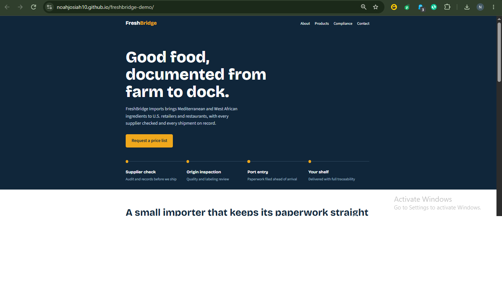

# FreshBridge Imports: Demo Website

A sample website I designed for a fictional food import company, to show my web design approach.

## About this project
- **Purpose:** Portfolio demo (fictional business)
- **Built with:** HTML & CSS
- **Sections:** Home, About, Products, Compliance, Contact

## Design goals
- Clean, mobile-friendly layout
- Clear structure that builds trust with buyers
- Easy for the owner to update

## Live demo
[View the site](https://noahjosiah10.github.io/freshbridge-demo/)

## Note
This is a demo with a made-up company. No real client data is included.
